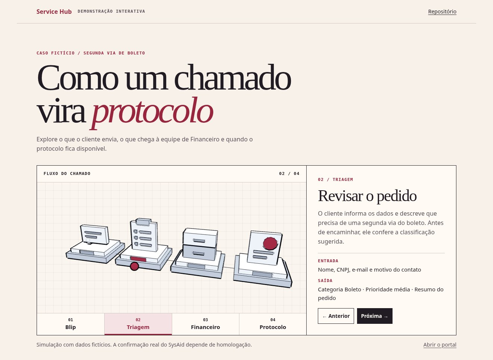
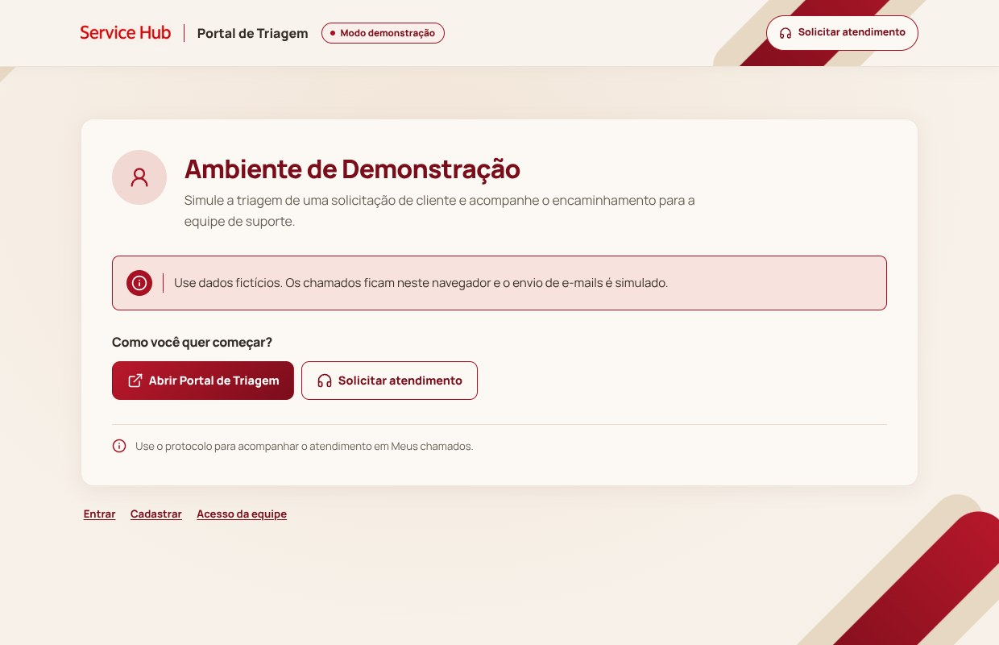
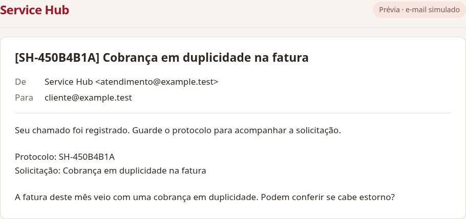

# Service Hub

Protótipo de autoatendimento para clientes. O portal orienta a resolução, abre chamados com o contexto da conversa e organiza o atendimento por fila e protocolo.

[Experimentar no GitHub Pages](https://dutragusta.github.io/Service-Hub/) · [Ver todas as capturas](docs/DEMONSTRACAO.md) · [Executar localmente](#executar-localmente)

## Como um chamado vira protocolo

Explore o pedido fictício de segunda via de boleto em quatro etapas. Na última, compare o protocolo de demonstração com o status de confirmação pendente.

[](https://dutragusta.github.io/Service-Hub/como-funciona/)

[Abrir a jornada interativa](https://dutragusta.github.io/Service-Hub/como-funciona/)

## Demonstração

**Cobrança em duplicidade.** O assistente sugere a fila Financeiro. O cliente revisa o relato, registra o pedido e acompanha o andamento pelo protocolo. Na demonstração local, a equipe encontra o mesmo protocolo na fila e pode assumir o atendimento.

[](docs/DEMONSTRACAO.md#cobrança-em-duplicidade)

### E-mail de confirmação

Prévia gerada com dados fictícios. A mensagem do cliente inclui o protocolo e a solicitação original. O encaminhamento ao suporte inclui também categoria, prioridade, fila e resumo.



O [exemplo de segunda via de boleto](docs/DEMONSTRACAO.md#segunda-via-de-boleto-via-blip) mostra, em uma execução separada, a entrada pelo Blip, o formulário, a revisão e a confirmação simulada com um protocolo `SYS-DEMO-…`.

## O que está disponível

| Ambiente | Comportamento |
| --- | --- |
| GitHub Pages | Portal, assistente por regras, base fictícia e chamados armazenados no navegador. E-mails simulados. |
| Demonstração local | Fila de analistas, registro e acompanhamento no navegador. Ollama opcional para escrever o resumo, com regras de contingência. |
| Triagem via Blip | Portal Python que demonstra o link assinado, a coleta de dados, a classificação, a revisão e a confirmação simulada do SysAid. Em modo demonstração, a mensagem é gravada em `outbox/`. |
| Worker autenticado | Cadastro, permissões e envio configurável por e-mail. A instalação depende da infraestrutura de identidade, do binding D1 e da configuração do provedor. |

O cliente pode anexar até três imagens JPG, PNG ou WebP ao abrir ou complementar um chamado, encerrar e reabrir o mesmo protocolo e avaliar o atendimento concluído. O cadastro solicita CNPJ. Use dados fictícios nas demonstrações.

## Executar localmente

Requisitos: Node.js 20.19+ ou 22.12+ e npm.

```bash
npm ci
npm run build
npm run demo
```

Abra `http://127.0.0.1:4173/`. Para desenvolver a interface, use `npm run dev`.

### Resumo com Ollama

Com o Ollama instalado, em execução no mesmo computador, baixe o modelo:

```bash
ollama pull llama3.1:8b
```

Reinicie a demonstração. Para uma opção mais leve, baixe `llama3.2:3b` e defina a variável de ambiente `OLLAMA_MODEL` com esse valor. O Ollama escreve o resumo. Categoria, prioridade e fila do Service Hub seguem as regras do portal. Se o modelo estiver indisponível, a demonstração usa um resumo por regras.

### Triagem via Blip

Requisito adicional: Python 3.11+. O portal Python original está no submódulo [Offmoura/Hackathon](https://github.com/Offmoura/Hackathon).

```bash
git submodule update --init integrations/blip-triagem
```

Crie um ambiente virtual e instale as dependências a partir da raiz do Service Hub.

**macOS e Linux**

```bash
python3 -m venv integrations/blip-triagem/.venv
integrations/blip-triagem/.venv/bin/python -m pip install -r integrations/blip-triagem/requirements.txt
```

**Windows (PowerShell)**

```powershell
py -3 -m venv integrations/blip-triagem/.venv
.\integrations\blip-triagem\.venv\Scripts\python.exe -m pip install -r integrations/blip-triagem/requirements.txt
```

Após executar `npm ci` e `npm run build`, inicie com `npm run demo:blip`. Em `http://127.0.0.1:4173/`, selecione **Triagem via Blip**. O portal Python usa a porta 8000 por padrão. As variáveis `BLIP_TRIAGE_PORT` e `BLIP_TRIAGE_PYTHON` permitem ajustar a porta e o executável. Para classificação por modelo, execute o Ollama com o modelo indicado na configuração do submódulo.

## Homologação

Os provedores de confirmação real do SysAid ainda são pontos de integração. O protocolo oficial, a fila efetiva e a recuperação após perda da confirmação precisam ser validados no ambiente autorizado.

| Cenário | Resultado esperado |
| --- | --- |
| Demanda financeira completa | O mesmo identificador acompanha o pedido até a fila e o protocolo confirmados no SysAid. |
| Informação insuficiente | A conversa solicita apenas os campos faltantes. |
| Mesmo pedido reenviado | O reenvio recupera o registro existente. A equipe confere no SysAid que há apenas um chamado. |
| Criação falha ou confirmação se perde | O fluxo informa que aguarda confirmação enquanto não há protocolo verificado. Se o registro existir, a nova tentativa recupera o mesmo número. |

Compare a fila sugerida pelo assistente, a primeira fila registrada no SysAid e a fila que o Atendimento considera correta.

## Manutenção

- **Publicação estática.** Execute `npm ci` e `npm run build:pages` quando houver mudanças no código publicado. Faça commit do `index.html` e dos arquivos compilados em `pages/assets/`. Alterações de documentação dispensam essa compilação.
- **Base de conhecimento.** Edite `src/data/base-atendimento.json` e recompile. O catálogo alimenta a busca, o diagnóstico e as orientações do assistente. Parte dos casos fictícios foi adaptada dos [cenários sintéticos do Offmoura/Hackathon](https://github.com/Offmoura/Hackathon/blob/main/data/chamados_sinteticos.json).
- **Worker e e-mail.** Aplique as migrações em `drizzle/` com o binding D1 `DB` e configure a camada de identidade. O proxy deve retirar os cabeçalhos de identidade enviados pelo cliente e inserir os dados da sessão validada. O envio usa `RESEND_API_KEY`, `TICKET_EMAIL_FROM` e `TICKET_SUPPORT_EMAIL`. O resumo por modelo no worker pode usar `OPENAI_API_KEY` e `OPENAI_SUMMARY_MODEL`.
- **Referências do projeto.** [Roteiro de demonstração](APRESENTACAO.md) · [Verificações](VERIFICACOES.md) · [Segurança](SEGURANCA.md).
