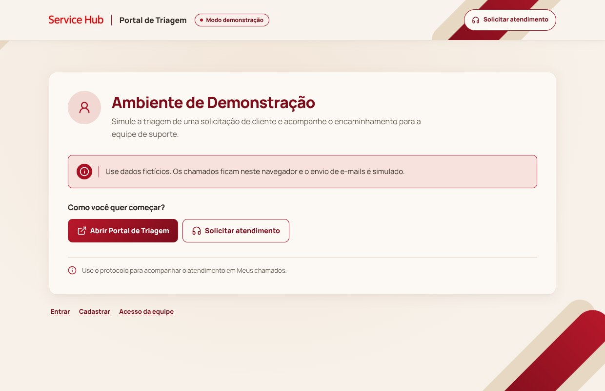
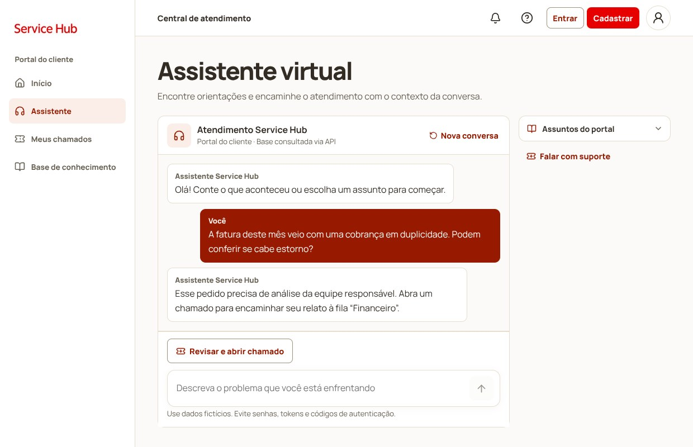
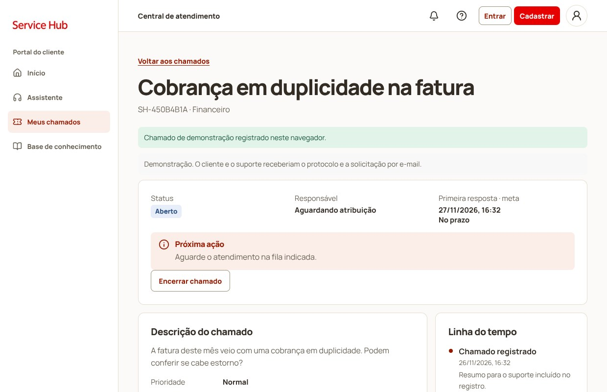
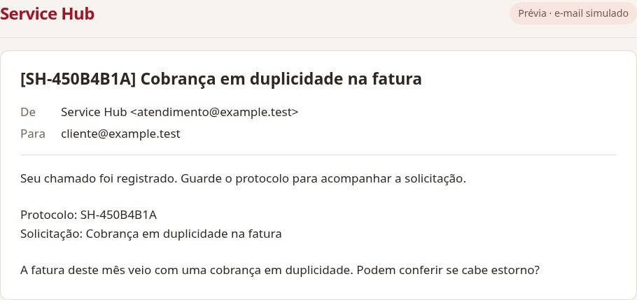
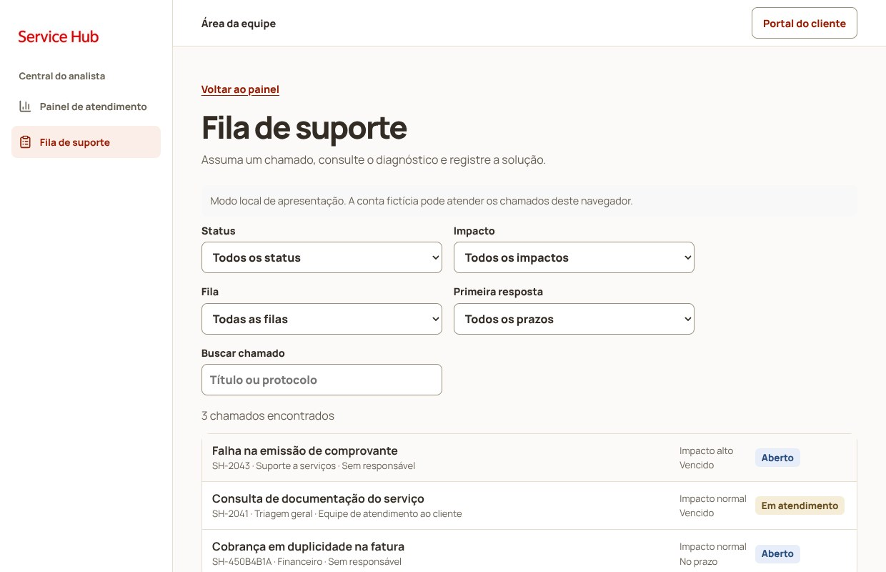
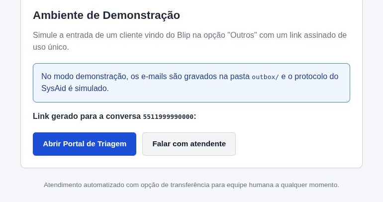
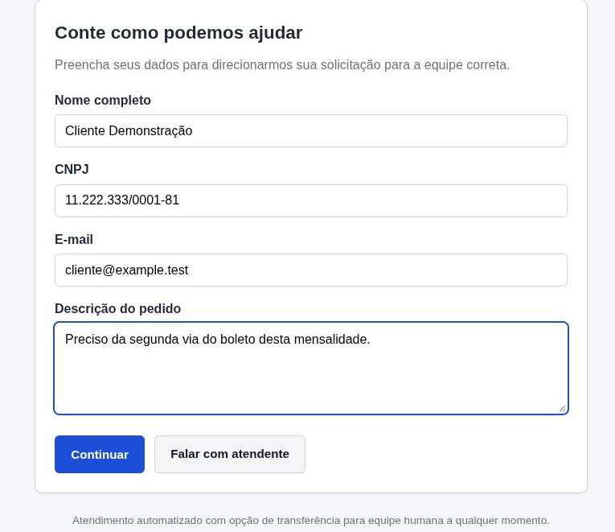
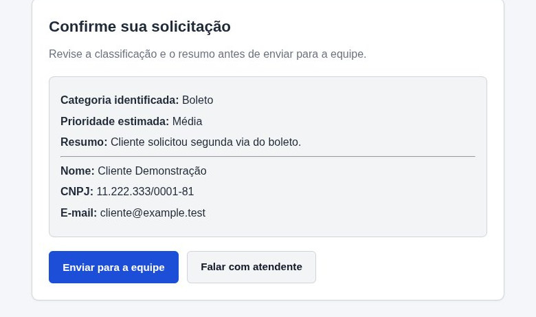
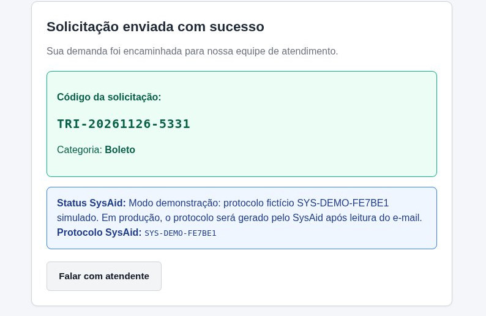

# Demonstração em imagens

[Voltar ao README](../README.md)

## Cobrança em duplicidade

### Portal de Triagem

### Encaminhamento pelo assistente

O cliente relata uma cobrança em duplicidade. O assistente identifica Financeiro e oferece o encaminhamento com o contexto da conversa.

### Protocolo e acompanhamento

O cliente acompanha o chamado pelo protocolo, consulta o status e vê as atualizações na linha do tempo.

### E-mail gerado

Na demonstração, a prévia da mensagem mostra o mesmo protocolo e preserva o relato do cliente. O destinatário e o remetente são fictícios.

### Fila de suporte

A equipe encontra o chamado na fila Financeiro e pode assumir o atendimento.

## Segunda via de boleto via Blip

Essa execução usa dados fictícios e uma resposta de classificação simulada do Ollama. A confirmação usa protocolo `SYS-DEMO-…`.

### Entrada

A página de demonstração representa a opção **Outros** do Blip e gera um link assinado de uso único.

### Formulário

O cliente informa nome, CNPJ, e-mail e motivo do contato.

### Revisão

O cliente confere categoria, prioridade e resumo antes de enviar para a equipe.

### Confirmação

O portal exibe o código da solicitação e o protocolo de teste do SysAid. O e-mail é gravado em `outbox/` no modo demonstração.

